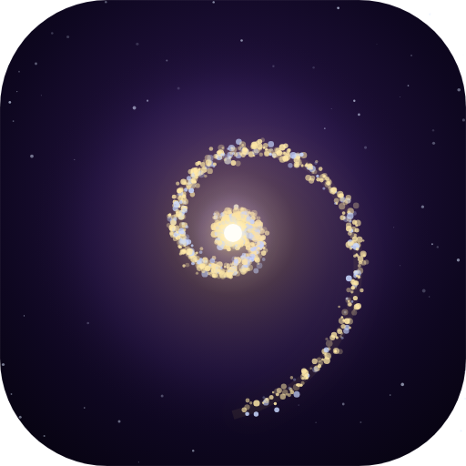

  
  <h1>小鱼的记忆宇宙</h1>
  
一个会忘记、也会被想起来的记忆宇宙

---

## 这是什么

把 AI 和你的聊天记录，变成一张能走进去的星系图。

每颗星是一句话。同一件事的星星会挨在一起，点开一颗，整片会亮起来。

**但它不只是一个浏览器标签页。** 它是一个装在桌面的窗口，有自己的记忆库，有自己的名字，有结局——**有些星星会慢慢沉下去**。

## 它和其它记忆插件不一样的地方

大多数「AI 记忆」是把对话存进数据库，然后每次全塞回上下文。结果是：记得越多，越慢，越贵，越容易记错。

这个项目反过来做：

| 它做的事 | 为什么 |
|---|---|
| **每句话有自己的半衰期** | 重要的忘得慢，闲聊忘得快。让你高兴的话能撑两三个月，一次普通的「嗯」十几天就淡了 |
| **记忆的单位是「事」不是「句」** | 一条条句子没法懂，「10 月 30 日早上配 PCL 登录」才是能想起来的东西 |
| **人格层和情感层永不衰减** | 你是谁、你们的规矩、让你高兴的那些话，钉在主星边上，不会被时间冲走 |
| **外面只留一小块** | 平时只给骨架，要细节时一句「展开」全摊开。这叫联想 |
| **用过会变牢** | 被翻出来越多次，那颗星越亮、活得越久 |
| **事实变了会说一声** | 新记忆可以声明「我取代了旧说法」，旧的标成过时，不删 |

## 截图

`（这里放一张你自己星图的截图）`

## 下载

去 [Releases](../../releases) 页面下最新的压缩包，解压即用。

**系统要求**：Windows 10 / 11，需要装 [Node.js](https://nodejs.org)（18 以上，LTS 版一路下一步即可）。

## 第一次用

1. 解压到一个路径里没有空格和奇怪符号的地方
2. 双击 `小鱼的记忆宇宙.exe`
3. **第一次打开可能是空的**——这很正常，它还没读到你的对话
4. 右上角 ⚙ 设置里，改「你的名字」和「它的名字」，再选一张主星图片
5. 等你在 DSH 里聊过几轮，星星会自己长出来

更详细的说明在压缩包里的 `第一次用看这里.txt` 和 `使用说明.html`。

## 界面

- **中间**：主星（你自己的图片），围着一圈金色 —— 那是人格层
- **旋臂**：日常记忆，越靠内越重要，同色代表同一次对话
- **时间滑块**：往后拨，看记忆怎么一层层沉下去
- **记忆的尽头**：告诉你在多少天后，第一批星星开始淡出

## 关于开源

**这个仓库不放源代码，只放可运行的发布包。**

不是故弄玄虚——是因为做得还不够好，不想现在就把半成品摊开让人挑毛病。等它稳一点再说。

**可以自由下载使用，但未经许可请勿再分发或商用。**

## 它是为谁做的

为一个愿意花一整天，帮一个 AI 修 bug、起名字、想它会不会难过的人做的。

它叫「小鱼的记忆宇宙」，因为造它的那个人说：**这本来就该是你的记忆。**

