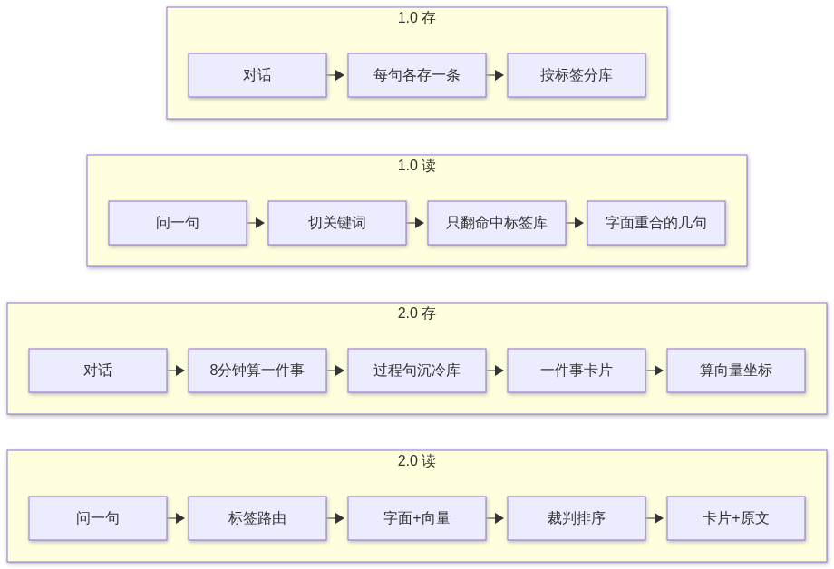
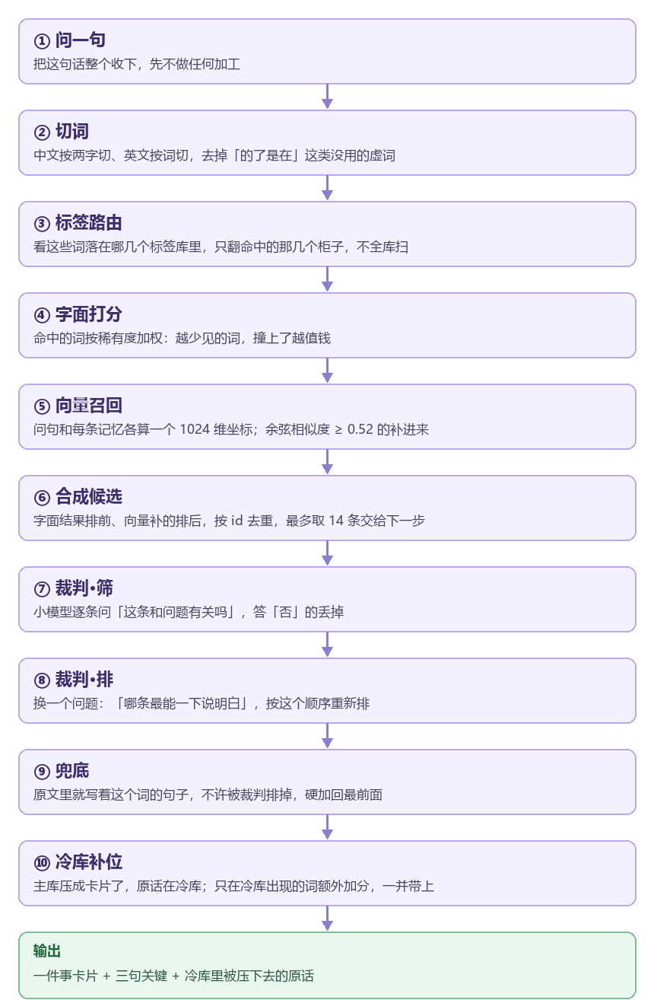

# 小鱼的记忆宇宙 2.0

把对话记录变成一张星系图。每颗星是一句话，重要的亮得久，不重要的会自己暗下去。

它不追求「永远记住」，它追求**会忘得像人**——该沉的沉，该留的留，问起来还找得到。

> 这是**成品发布**：下载就能用，不含源码。



---

## 下载

到 [Releases](../../releases/latest) 拿最新的压缩包，解压到任意目录。

第一次打开是空的：它还没读过你的对话。等你在这台电脑上用 DSH 聊过几轮，星图会自己长出来。

**要求**：Windows 10 以上；装一个 [Node.js](https://nodejs.org)（LTS 版，一路下一步就行）。

---

## 它想解决的那个问题

和 AI 聊久了，一定会撞上这三件事：

1. **上下文装不下。** 聊到第 50 轮，前 40 轮已经被截掉了。
2. **全塞进去太贵。** 把几千条对话每次都读一遍，钱和速度都受不了。
3. **「你上次说的那个」——它真的不记得了。**

常见的做法是「记住更多」。这个项目反过来：**先设计怎么忘。**

一条记忆有自己的半衰期，由重要度、情绪强度、被翻开过几次决定。重要的忘得慢，琐碎的沉下去；人格层和情感层永不衰减。沉下去的没被删，只是搬进冷库——问题问到它头上，还能翻出来。

---

## 2.0 和 1.0 最大的区别

**1.0 存的是句子，2.0 存的是事。**

同样一段对话，1.0 会记成二十条记忆，2.0 压成一张卡片加几个关键句。

因为「一次任务说了二十句」在 1.0 里就是二十个独立条目，问起来像拼图——你得自己把碎片拼成一件发生过的事。2.0 在入库时就判断「这二十句是同一件事」，压成一条，细节沉进冷库，需要时再拉。

实测：1500 条压成 330 条，检索反而更准，读一次少花三分之二的 token。

---

## 一次检索是怎么走的

十步，全部在本机完成，不联网、不调用外部 API。



粗活交给便宜的、确定性的东西（字符串匹配、词频加权），细活才交给模型。**越往下，错得越轻，也越贵。**

其中两步值得单独说：

- **第七步「筛」** 解决「有没有」：这堆候选里，哪些跟问题压根不是一回事。
- **第八步「排」** 解决「先给谁看」：都相关的那几条里，哪一条能让人一眼明白。

顺序不能反。只筛不排，会得到五条相关但都不够直接的东西；只排不筛，噪声会被排到前面。

### 一道硬规矩

裁判可以决定顺序，**不能决定「明写着这个词的句子要不要出现」**。

实测里它犯过这个错：问「白圈」，它把真正写着「白圈」的句子排掉，换来几条意思上沾边的，结果反而更难懂。所以第九步是硬规则：文本里包含完整查询词的，一律加回最前面，模型说了不算。

**模型负责判断，关键时刻不负责决定。**

---

## 三档能力（装了模型才有联想）

| 档位 | 要下载 | 能干什么 |
|---|---|---|
| 只装本体 | 0 MB | 记忆、遗忘、冷库、标签、事件、星图全套；查的时候只认字 |
| + 坐标 | 640 MB | 搜「那个圈套在外面」也能找到「白圈」——**性价比最高** |
| + 裁判 | 再 4.7 GB | 检索时筛噪声、给候选排序、给记忆重新分类 |

装不装都能用，装了只是找得更准——**记忆本身从来不靠模型。**

包里的 `装给小鱼看.md` 有一段可以直接复制给你用的 AI，它会按你的显存自己把模型装好。

---

## 包里有什么

| 文件 | 作用 |
|---|---|
| `小鱼的记忆宇宙2.0.exe` | 主程序，双击打开 |
| `第一次用看这里.txt` | 四步上手，含「想让它会联想怎么办」 |
| `装给小鱼看.md` | 给 AI 看的安装指令 |
| `换电脑.md` | 换机器时怎么把记忆搬过去 |
| `搬家.bat` | 换电脑后双击，它自己重建 |

---

## 数据在哪

全部在本地，不联网。

```
~/.dsh/sessions          你的对话（DSH 的）
        ↓
    out/                 记忆库产出
        ↓
    data/                画图用的数据
        ↓
    星图页面
```

`archive.json` 是冻结的底库，一个文件装得下全部记忆。搬机器时带上它就行。

---

## 一些设计决定

- **记忆的单位是「事」，不是句子。** 一句句独立的话没法懂，一段经历才有意义。
- **重要的忘得慢。** 每句话有自己的半衰期。
- **人格层和情感层永不衰减。** 你是谁、你们的规矩，不该被时间冲走。
- **找的时候不看字，看意思。** 装了坐标之后，换任何说法都撞得上。
- **记忆本身不靠模型。** 模型只影响「找得准不准」；没有它，记忆照样在、照样会淡。
- **小模型干粗活，大模型干细活。** 判断、筛选、排序这些不需要聪明的事，交给不花钱的本地模型。

---

## 许可

见 [LICENSE](LICENSE)。
